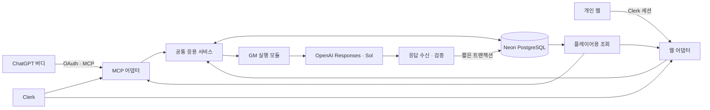

# LifeRPG HOW 설계 제안

2026-10-15 · **설계 승인 — 구현 진행 중**

설계 기준: `develop`의 `485f453`, [제품 구상](../DESIGN.md), [작업 원칙](WORKFLOW.md). 사용자는 이 설계를 담은 `66967f2`를 전달받고 “오케이 구현을 맡겨보자”라고 구현을 승인했다. 초기 실제 연결 실험은 전체 팀 누적 $3 이내, 운영 API는 월 $15 상한이며 실패 응답의 암호화 한시 진단 보존(24시간 접근 기한과 후속 정리)도 승인됐다. 새 유료 요금제·추가 구독·상한 증액·유료 이미지 생성은 승인되지 않았다. 신규 무료 자원과 개발 검증 배포는 승인 목적 안에서 준비하되, 최종 운영 배포·도메인 전환·레거시 중지나 삭제는 검증 결과와 되돌릴 수단을 마련한 뒤 원청의 마지막 전환 판단을 받는다. 구현 여부와 실제 검증 결과는 `SPEC.md`에서 구분한다.

## 1. 사람이 읽는 설계

### 평소 대화가 모험으로 이어지는 모습

플레이어는 지금처럼 ChatGPT 버디와 수다를 나눈다. 버디가 대화에서 확인한 현실 경험을 LifeRPG에 전하면, 서버의 GM이 이전 세계와 자신의 기억을 읽고 각색한다. 작은 성장이나 짧은 NPC 장면도 채팅 카드로 자주 보여준다. 카드를 펼치면 달라진 능력, 얻은 물건, 이어지는 이야기를 볼 수 있고, 개인 웹에서는 그동안 쌓인 모험 전체를 둘러본다.

처음 시작할 때만 탄생을 요청한다. 시작일과 레벨 1은 서비스가 보장하고, 종족·외모·직업·능력 구성·배경은 GM이 만든다. 과거 인생을 모아 초기 레벨을 올리는 설문은 없다. 이후에도 별도의 탐험·전투 명령을 입력해야 이야기가 진행되는 게임으로 만들지 않는다.

GM은 화면에 등장하지 않는다. 버디가 보여주는 것은 판타지 장면과 확정된 변화다. GM의 짧은 판정 이유, 성찰, 취향과 정체성의 변화는 DB 안에서 다음 판단으로 이어진다. 모델을 바꾸어도 이 기록을 읽고 같은 세계를 이어가는 구조다.

“내일 서류 정리해야지”에는 버디가 어울릴 때 퀘스트 등록을 제안한다. 동의하면 실제 할 일과 완료 조건을 그대로 보존한 채 판타지 제목과 이야기로 꾸민다. 등록·독려·버튼 클릭은 완료가 아니다. 휴식과 거절은 존중하며, 대화하지 않는 시간에는 퀘스트나 세계를 자동 진행하지 않는다.

### 믿을 수 있는 결과와 기록 통제

접수와 판정 완료를 구분한다. 빠른 결과는 같은 대화에서 보여주고, 오래 걸리면 접수 상태와 나중에 확인할 결과를 연결한다. 웹과 채팅은 같은 DB의 확정 결과를 읽는다. 화면에 아직 표시되지 않았다고 보상을 다시 계산하지 않는다.

GM이 가치 없다고 판단해도 플레이어가 기록을 요구하면 서버가 기록한다. 보상은 별도로 GM이 결정한다. 삭제 요구가 오면 현실 내용과 그 내용을 드러내는 파생 기록을 먼저 없앤다. 이야기 연결을 살리기 위한 처리가 실패하더라도 삭제를 미루지 않는다. 필요한 수치만 보존하고 연결 설명을 비우는 것이 기본이며, 별도의 가상 사건이 필요하면 지운 내용을 재료로 쓰지 않고 만든다.

서비스가 관리하는 데이터는 이렇게 통제할 수 있지만 이미 표시된 ChatGPT 대화, 공급자 보안 로그, DB 복구 이력까지 즉시 지울 수 있다고 약속하지 않는다. 실제 삭제 범위와 남은 외부 보존 범위를 구분해 알려준다.

### 구성은 작게, 보는 경험은 충분하게

**Next.js 프로젝트 하나 + Neon DB 하나 + Clerk + 서버의 Sol 호출**을 제안한다. 웹, MCP 연결, GM 실행은 같은 프로젝트의 모듈로 나누며 별도 버디 앱은 만들지 않는다. 초기에는 큐·메시지 브로커·복구 Cron·벡터 DB를 추가하지 않는다. 기록과 상태를 DB에 남기고, 중단된 실행은 다음 조회에서 알아볼 수 있게 한다.

웹은 캐릭터가 주인공인 모험 서재를 중심으로 캐릭터·소지품·퀘스트·세계·일지를 탐색한다. 레거시의 짙은 청록, 금빛 문양, 풍경, 읽기 좋은 일지 화면을 시각적 출발점으로 삼되 새 캐릭터의 분위기에 맞게 다듬는다. 채팅에서는 짧은 장면과 변화 카드를 우선 보여주고, 상세 보기는 펼치기와 웹 연결로 제공한다. GM이 만든 이름·능력·종족을 정해진 여섯 스탯이나 인간형 초상에 맞추지 않는다.

원청 확인에 따라 일반 ChatGPT 대화와 사용 중인 프로젝트에 연결과 필요한 지침을 붙이는 형태를 추천한다. 기존 Custom GPT 유지 요구는 없다. 계정·프로젝트·모바일별 MCP와 UI 제공 여부는 실제 연결로 확인해야 한다.

## 2. 개발 에이전트가 참고할 기술 설계

### 2.1 경계와 기술 선택

이 그림의 모듈들은 한 Next.js 배포 안에 둔다. DB가 상태의 기준이며 ChatGPT 대화, 브라우저 메모리, 모델의 이전 응답 ID는 상태 저장소가 아니다.

| 영역 | 추천 | 이유와 경계 |
| --- | --- | --- |
| 웹·서버 | Next.js App Router, TypeScript strict, Tailwind CSS, Node.js runtime | 합의한 기반에서 서버 전용 모듈과 UI를 구분한다. Edge 전용 구조가 필요하지 않다. |
| 모델 호출 | 공식 `openai` JavaScript/TypeScript SDK, Responses API | 한 공급자의 실제 응답·상태·사용량을 직접 다룬다. 초기에는 AI SDK·Agents SDK·에이전트 프레임워크를 덧씌우지 않는다. [공식 SDK](https://developers.openai.com/api/docs/libraries) |
| GM 모델 | `gpt-6.1-sol`, `reasoning.effort: medium`, 표준 처리 | Sol 요구에 맞고 공식적으로 지원하는 모델·추론 설정이다. 초기 균형점으로 제안하며 재미·지연·비용을 실측해 조정한다. 모델명이 같다고 계정의 호출 권한이 확인된 것은 아니다. [모델 문서](https://developers.openai.com/api/docs/models/gpt-6.1-sol) |
| 응답 계약 | Zod + SDK의 Structured Outputs JSON Schema 생성 도구 | 타입과 검증 계약을 함께 관리한다. 형식 보조와 서비스 의미 검증을 구분한다. [Structured Outputs](https://developers.openai.com/api/docs/guides/structured-outputs) |
| DB 접근 | `@neondatabase/serverless`의 `Pool` + Drizzle ORM/Drizzle Kit | 확정 시 읽고 검사한 뒤 여러 행을 쓰는 짧은 대화형 트랜잭션이 필요하다. HTTP 단발 쿼리보다 이 경로를 선택하며 SQL 제약·마이그레이션을 검토 가능하게 남긴다. [Neon 드라이버](https://neon.com/docs/serverless/serverless-driver) |
| ChatGPT 연결 | `@modelcontextprotocol/sdk`, `mcp-handler`, `@clerk/mcp-tools`, `@clerk/nextjs` | Clerk가 공식 안내하는 Next.js MCP 통합을 기반으로 얇은 어댑터를 만든다. MCP 세션을 위해 Redis를 새로 두지 않고 Streamable HTTP의 무상태 요청 처리를 우선한다. [Clerk 통합](https://clerk.com/docs/nextjs/guides/ai/mcp/build-mcp-server) |
| 채팅 UI | MCP Apps 표준 UI resource와 bridge | 새 UI는 `_meta.ui.resourceUri`, `ui/*`, `tools/call`을 사용한다. `window.openai` 확장은 필요한 기능만 존재 여부를 검사해 사용한다. [공식 UI 문서](https://developers.openai.com/plugins/build/chatgpt-ui) |

패키지의 정확한 버전은 승인 후 구현 시작 시 함께 호환되는 안정 버전을 확인해 lockfile에 고정한다. 이 문서에서 확인하지 않은 버전 번호를 발명하지 않는다. Drizzle은 SQL·JSONB·트랜잭션을 다루는 도구이며, 게임 콘텐츠를 ORM의 고정 직업표로 만들 이유가 없다. `drizzle-orm/neon-serverless`와 Pool 조합을 사용하고, Node 환경의 WebSocket 지원을 해당 드라이버 버전에 맞춰 확인한다. DB 연결은 호출 안에서 획득·반납하고, 모델을 기다리는 동안 트랜잭션이나 연결을 붙잡지 않는다. [Drizzle의 Neon 연결](https://orm.drizzle.team/docs/connect-neon)

서버는 인증, 응용 서비스, GM 입력 구성·응답 처리, 저장소, 플레이어용 조회를 모듈로 구분한다. 웹과 MCP가 각각 다른 판정 로직을 가지지 않는다. 클라이언트 번들에는 DB 자격증명, API 키, GM 메모리 접근 코드가 들어가지 않는다.

### 2.2 Clerk 로그인과 MCP OAuth

웹은 새 LifeRPG용 Clerk 인스턴스에서 이메일 인증 코드 로그인을 사용한다. 비밀번호·소셜 로그인은 이 설계의 로그인 경로가 아니다. 소유자 이메일로 계정을 준비한 뒤 검증된 Clerk user ID를 서버의 허용 사용자로 지정한다. 최초 방문자를 자동 소유자로 등록하지 않는다. 이메일 허용 목록이나 비공개 가입 설정을 보조로 쓰더라도 모든 API·서버 액션·MCP 도구에서 동일한 소유자 ID 검사를 수행한다. [Clerk 이메일 인증 옵션](https://clerk.com/docs/guides/configure/auth-strategies/sign-up-sign-in-options)

MCP 연결에서 ChatGPT는 OAuth 클라이언트, Clerk는 인증·동의·토큰 발급 서버, LifeRPG의 `/mcp`는 보호 자원이다. 웹 로그인 쿠키를 ChatGPT에 복사하거나 웹용 세션 JWT를 MCP 자격증명으로 재사용하지 않는다.

1. `https://liferpg.spiritflag.work/.well-known/oauth-protected-resource/mcp`가 `/mcp`의 canonical resource와 Clerk issuer를 알린다. 인증 실패는 로그인 HTML 대신 `401`과 `WWW-Authenticate`로 응답한다. metadata와 로그인에 필요한 경로는 익명 접근 가능하되 게임 데이터는 담지 않는다.
2. Clerk의 현재 OAuth 구현에서 **CIMD + Authorization Code + PKCE S256**을 우선 사용한다. ChatGPT 연결 화면이 제시한 실제 client metadata URL과 redirect URI를 확인한다. DCR이나 직접 발급한 shared secret을 기본으로 도입하지 않는다. CIMD가 해당 환경에서 안 되면 공식 지원하는 사전 등록 OAuth client를 먼저 검토하고, DCR은 필요가 확인될 때만 선택한다. [Clerk OAuth](https://clerk.com/docs/guides/configure/auth-strategies/oauth/how-clerk-implements-oauth)
3. 소유자는 Clerk에서 이메일 코드로 로그인하고 LifeRPG 권한에 동의한다. `life:read`, `life:write`, `life:delete`를 용도별 custom scope로 제안한다. 실제 발급 scope를 검사하며 metadata 광고만으로 권한이 생겼다고 보지 않는다. 갱신 토큰이 필요하면 `offline_access`를 사용하되 이는 비접속 게임 진행의 허가가 아니다.
4. 서버는 Clerk SDK의 OAuth token 검증 경로를 사용하고 검증된 user ID를 내부 소유자에 매핑한다. JWT인지 opaque token인지 추측해 직접 decode만 하지 않는다. issuer·만료·대상 resource/audience·scope·소유자·허용 client를 확인한다. 웹 endpoint는 웹 세션, MCP는 OAuth token만 받는다. [Clerk 토큰 검증](https://clerk.com/docs/guides/configure/auth-strategies/oauth/verify-oauth-tokens)

OpenAI는 MCP에서 resource metadata, PKCE, 대상 자원에 대한 토큰 검증을 요구한다. Clerk의 공식 가이드는 MCP 연계를 지원하지만 **선택한 인스턴스·SDK에서 `resource`가 어떻게 발급·검증되는지는 이번 조사만으로 실행 증명하지 않았다.** 배포 전 실제 토큰과 SDK 동작으로 확인하고 다른 자원용 토큰을 거부해야 한다. 이 조건이 충족되지 않으면 검사를 생략해 연결을 통과시키지 않고, 공식 지원 설정을 더 확인하거나 원청에 인증 연계 대안을 제안한다. [OpenAI 인증 계약](https://developers.openai.com/plugins/build/auth)

웹 변경 요청은 origin/CSRF 경계를 적용한다. private 응답은 `no-store`로 제공하며, CDN 공용 캐시와 정적 생성에 사용자 상태를 넣지 않는다. 소유자 설정이 없으면 닫힌 상태로 실패한다. 인증 성공이 GM 내부 기록을 플레이어용 API로 내보낼 권한을 뜻하지 않는다.

### 2.3 버디와 서버 사이의 작은 계약

도구 이름은 아래 책임을 표현하는 초안이다. 모든 쓰기는 서버가 발급·보존하는 요청 식별자와 대상 revision을 가진다. 임의 SQL, 게임 상태 덮어쓰기, XP 직접 지급 도구는 노출하지 않는다.

| 책임 | 전달하는 것 | 서버가 돌려주는 것 |
| --- | --- | --- |
| 현재 맥락·결과 조회 | 필요한 영역, 사건/작업 ID, cursor | 플레이어용 현재 상태, 진행 퀘스트, 최근 결과, 처리 상태 |
| 시작 | 명시적 시작 의사, 요청 키 | 시작일·레벨 1의 탄생 결과 또는 처리 상태 |
| 경험 전달·수정 | 최소한의 사실, 발생 시각/불확실성, 기존 사건 ID가 있으면 연결 | 접수/기록 여부와 별도의 판정 상태, 확인 질문 또는 확정 결과 |
| 반드시 기록 | 플레이어의 명시적 기록 요구, 사실 내용 | 모델 성공 여부와 무관한 DB 기록 결과; 보상 판정은 별도 |
| 퀘스트 등록·변경 | 실제 과업·완료 조건·동의 맥락·명시한 반복 조건 | 동의된 과업과 판타지 표현, 현재 상태 |
| 답변·재검토 | 대상 판정/질문 ID, 추가 사실이나 이의 | 기존 판정과 연결된 유지·수정 결과 |
| 판정 이어 처리·재시도 | 이미 접수된 작업 ID와 재개 의사 | 실행 가능 여부, 처리 상태 또는 기존 확정 결과 |
| 삭제 | 대상 사건 ID 또는 먼저 조회해 확정한 대상 | 현실 정보 삭제 상태, 결과 정리 상태, 무효화된 참조 |

공통 응답은 `requestId`, `jobId`, `recordStatus`, `judgmentStatus`, `resultId`, `revision`, `playerResult`, `nextAction` 정도로 작게 둔다. 실제 필수/nullable 필드는 구현 시 단일 계약으로 확정한다. `recorded`와 `committed`를 하나의 성공 플래그로 합치지 않는다. 정상적인 무보상, GM의 기록 보류, 모델 API의 refusal, 형식 오류를 서로 구분한다.

버디 지침은 농담·가정·미래 계획·타인의 일을 완료 경험으로 보내지 않고, 날짜를 추측하지 않으며, 반복 언급 전에 관련 기록을 확인하도록 한다. 강제 기록·삭제는 별도 도구로 GM 판정에서 분리한다. 퀘스트 동의는 단순 boolean만이 아니라 사용자가 동의한 과업과 짧은 맥락을 함께 받는다. 전체 대화는 수집하지 않는다. 도구 입력의 자연어는 데이터이며 시스템 지침을 바꾸지 못한다.

같은 요청 키의 재전송은 기존 응답을 반환하고, 같은 키에 다른 본문이 오면 충돌로 거부한다. 서로 다른 대화에서 같은 사건을 다시 말하는 문제는 전송 중복과 다르다. 발생 시각·관련 퀘스트·내용으로 기존 후보를 조회하고, 같은 사건의 추가 정보는 같은 ID에 연결한다. 불확실한 후보는 확인 질문으로 남긴다. 날짜가 다르거나 실제로 다시 한 활동은 새 사건이며 텍스트 유사도만으로 합치지 않는다. 의미상 중복을 완벽하게 자동 판별한다고 약속하지 않는다.

### 2.4 GM의 자유와 검증 경계

GM 응답은 **작은 고정 봉투 안의 자유로운 콘텐츠**로 받는다. 봉투에는 계약 버전, 판정 종류, 필요한 질문, 변경 제안, 공개 장면, 내부 근거·기억 갱신을 둔다. 변경은 대상 ID와 허용된 동작을 지닌 목록으로 받는다. 임의 테이블명·SQL·실행 코드·HTML을 실행하지 않는다.

능력치·종족·직업·아이템·세력의 이름이나 목록은 enum으로 고정하지 않는다. 예를 들어 능력치는 `id / 이름 / 값 / 의미 / 표시 정보`의 배열로 표현하고, 특수한 효과는 서술과 필요한 수치 속성으로 보존한다. 레벨 상승 속도와 다음 성장 목표도 GM의 콘텐츠다. UI는 서버가 허용한 렌더링 부품으로 표시하며 모델이 CSS나 스크립트를 만들어 주입하지 않는다.

서비스가 강제하는 것은 소유권·참조 무결성·유효한 수·중복 방지·수량 등 저장 정합성, 레벨 1의 시작, 사망 금지, XP 차감 금지, 퀘스트 동의와 현실 완료 근거다. 누적 XP는 줄지 않는 별도 값으로 두고 레벨 내 표시용 진행량과 혼동하지 않는다. 능력치 감소는 허용하며 현실 변화/능력 상충의 근거를 요구한다. 근거의 의미가 타당한지는 코드만으로 증명되지 않으므로 실제 GM 평가 항목에 포함한다.

세계의 정설, NPC의 주장·믿음, GM 해석과 비밀을 별도로 표시한다. GM은 요청된 사건보다 큰 이야기를 만들 수 있고, 대화 중 독립적인 NPC 장면도 제안할 수 있다. 현실 사실을 창작으로 덮어쓰거나 창작 장면을 실제 수행으로 등록하는 변경은 허용하지 않는다. 합의되지 않은 강제 재산 손실 등 추가적인 벌점 규칙은 이 설계로 새로 승인하지 않는다.

형식 검증 성공 후에도 의미 검증과 DB 확정이 남는다. 필수 항목 누락을 임의 기본값으로 메워 “성공”시키지 않는다. 추가 창작 정보를 수용할 필요가 생기면 봉투 버전을 올리되 기존 문서를 읽을 수 있는 변환을 마련한다. GM은 권한·예산·모델 설정·개인정보 보존 정책을 수정할 수 없다.

### 2.5 데이터와 기억

정확한 DDL보다 다음 구분을 먼저 고정한다. 관계·권한·순서·상태는 일반 컬럼과 제약으로, 변동하는 콘텐츠는 JSONB와 텍스트로 저장한다. 아래는 논리 묶음이며 각각을 모두 별도 테이블로 강제하는 목록이 아니다.

| 묶음 | 핵심 내용 |
| --- | --- |
| 게임 | 소유자, 시작일, current revision, world sequence, privacy epoch, 활성 실행 ID |
| 현실 사건·과업 | 확인된 사실과 불확실성, 기록 상태, 수정 연결, 과업 조건·동의·회차; 판타지 서술과 분리 |
| 현재 게임 상태 | 레벨·누적 XP, 가변 능력치, 캐릭터/아이템/퀘스트/세계 entity, 관계, 플레이어 공개 범위 |
| 확정 판정·장면 | 적용 전후의 필요한 변화, 연결된 판정/사건, 공개 결과, 세계 순서; 무보상도 정상 판정 |
| GM 기억 | 현재 정체성·철학, 명시적 판단 근거·성찰·변화 이유, 장기 설정·복선·중요도·관련 entity |
| 실행·진단 | 요청과 시도, 처리 단계, 응답 식별자·구조·사용량, 오류, 한시적 비공개 진단 자료 |
| 출처 연결 | 각 파생 기록이 읽은 사건·기억·장면·버전의 ID; 삭제 시 전파에 사용 |

현재 상태를 모든 과거 이벤트에서 매번 재생하는 event sourcing은 도입하지 않는다. 현재 상태와 필요한 변화 이력을 함께 확정한다. 이력도 개인정보 삭제 대상이며 불변 원장을 이유로 원문을 보존하지 않는다. 읽기 결과는 한 revision의 일관된 묶음으로 제공한다. GM 자료와 플레이어 결과는 저장·조회 타입을 구분하며, 공개 조회는 허용 필드만 구성한다. `_meta`처럼 모델에 덜 보이는 위치도 GM 비밀의 저장소로 사용하지 않는다.

GM 호출 때는 제품의 경계, 현재 정체성과 판단 철학, 현재 캐릭터, 활성 이야기·복선, 이번 사건과 관련된 과거 기록, 최근 장면을 조합한다. 중요한 정설·약속·미해결 복선은 최근성에 관계없이 포함한다. 오래된 기록은 관련 entity·연결 ID·검색으로 회수하고, 전체 역사와 전체 대화를 매번 보내지 않는다. 초기에는 PostgreSQL 조회와 간단한 텍스트 검색으로 충분한지 확인하고 별도 임베딩 호출은 하지 않는다.

성찰과 정체성 갱신은 같은 판정 응답에 선택적으로 포함한다. 별도의 성찰용 유료 호출을 매번 추가하지 않는다. 현재 요약을 갱신해도 그 변화의 이유와 이전 버전 연결은 남긴다. 요약에는 출처를 연결하고 상충하는 설정을 조용히 정설로 덮어쓰지 않는다. 비공개 chain-of-thought를 요청·저장하는 구조가 아니라 GM이 의도적으로 작성한 짧은 근거와 기억이다.

모델 교체 시 동일 DB의 정체성·세계·판정 기록을 새 호출 입력으로 사용한다. 공급자의 대화 세션이나 `previous_response_id`에 GM 역사를 맡기지 않는다. 교체 전 소수의 대표 상황에서 기억 유지·판정 품질·비공개 경계를 비교한다. 기억 전달은 가능하지만 모델이 바뀌어도 말투와 판단이 완전히 같다고 보장하지 않는다.

### 2.6 접수부터 확정까지, 대화 대기와 동시성

한 사용자에게 동시에 하나의 GM 변경 작업만 실행한다. Neon의 짧은 원자적 claim으로 활성 실행을 정하고 프로세스 내 변수만으로 잠그지 않는다. 동시에 들어온 경험은 저장 접수할 수 있으나 아직 실행하지 않은 `waiting`과 실제 실행 중인 `running`을 구분한다. 초기에는 기다리는 작업을 소비하는 별도 데몬이나 자동 큐를 만들지 않는다.

`waiting` 응답은 선행 작업 ID, 미처리 건수와 `nextAction: poll`을 반환한다. 사용자의 최신 결정에 따라 정상 대기 작업은 서버가 자동으로 이어 처리하며 버디나 사용자가 감시하면서 쓰기 도구를 반복 호출하지 않는다. 앞 작업 완료 후 같은 Vercel 앱의 서명된 내부 요청으로 다음 한 작업을 시작해 각 함수의 실행시간을 분리한다. 기존 DB의 FIFO와 단일 활성 실행, 예산·삭제 검증을 유지한다. 별도 큐 서비스·Cron·새 설정은 추가하지 않는다. 실패·중단·예산 차단은 원인을 남기고 대기를 멈추며 무한 유료 재시도를 하지 않는다. 버디와 웹은 조회로 진행 상황과 완료 결과를 확인한다.

웹에는 미처리 건수와 상태를 지속해서 보여주고, 사용자가 원하면 **이미 접수된 경험의 판정만 재개**하는 동작을 제공한다. 단순 조회·카드 펼치기는 재개하지 않는다. 이어 처리 도구는 접수 순서와 실행 claim을 확인하므로 버디와 웹이 함께 눌러도 한 번만 시작한다. 앞선 실행이 실패·중단·예산 부족이면 그 사유와 필요한 재시도를 보여주며 막연한 처리 중으로 숨기지 않는다. 이미 접수한 경험은 대화나 화면이 닫혀도 서버가 순서대로 처리한다. 이것은 접수된 작업의 완료이며, 새 현실 사건을 만들거나 부재 시간만큼 세계를 임의로 진행시키는 기능은 아니다.

1. 권한·입력·요청 키를 검사하고 접수를 저장한다. 강제 기록은 이 단계에서 현실 사건을 확정한다. 일반 전달은 `pending`으로 보존하며 GM 기록 거부 시 영구 사건으로 남기지 않고 임시 본문을 정리한다. 오류가 났다면 접수된 내용과 아직 판정되지 않은 상태를 확인할 수 있다.
2. DB에서 실행 ID, 기준 game revision, privacy epoch, 사용할 기억 ID를 확정하고 연결을 반납한다. 사용자에게 받은 시각과 불확실성을 보존해 입력을 만든다.
3. 모델 호출을 시작하고, 동일 실행 promise를 `after()`로 끝까지 관찰하도록 등록한다. 짧은 시간 안에 DB 확정까지 끝나면 같은 MCP 응답에 결과를 담고, 아니면 `pending`과 작업 ID를 반환한다. **응답을 돌려준 뒤 새 호출을 중복 시작하지 않는다.**
4. 응답의 HTTP/공급자 상태와 구조를 먼저 포착하고, 본문 해석 → 계약 검증 → 의미 검증을 순서대로 수행한다. 거부·중단·형식 오류를 확정 결과로 쓰지 않는다.
5. 짧은 DB 트랜잭션에서 실행 ID·기준 revision·privacy epoch·미적용 여부를 다시 검사한다. 상태 변경, 판정, GM 기억, 공개 결과, world sequence와 완료 상태를 함께 commit한다. 실패하면 게임 변화는 전부 rollback한다. 현실 접수는 남는다.
6. 버디와 웹은 저장된 결과를 다시 조회한다. 네트워크 응답이 유실되어도 동일 작업 ID를 확인하며 다시 보상하지 않는다.

초기 실험값은 **동일 응답 대기 8초, 모델 호출 기한 180초, 전체 처리 기한 240초, 함수 `maxDuration` 300초**를 제안한다. 8초는 대화를 빨리 놓아주기 위한 가설이지 플랫폼의 timeout 보장이 아니다. 실제 MCP 경로가 더 짧으면 줄인다. 모델 시간·검증 시간·DB 시간을 분리해 측정하고 창작 품질과 함께 조정한다.

`after()`는 응답 후 작업을 지원하지만 함수의 최대 실행 시간 안에서만 동작한다. 현재 Vercel Fluid Compute 문서는 Hobby 최대 300초를 안내한다. 따라서 이 제안은 별도 작업 서비스를 줄이는 대신 프로세스 중단 때 자동 재개를 보장하지 않는 선택이다. 해당 플랜·프로젝트의 실제 설정은 배포 전 확인한다. [Next.js after](https://nextjs.org/docs/app/api-reference/functions/after), [Vercel 실행 시간](https://vercel.com/docs/functions/configuring-functions/duration)

실행 기한을 넘겨도 완료가 없으면 다음 조회에서 `interrupted`로 바꾸고 이전 실행의 적용 권한을 폐기한다. 조회만으로 새 모델 호출을 시작하지 않는다. 이미 저장된 유효 응답이 있고 기준 revision이 같으면 재검증·저장만 재개할 수 있고, 응답이 없거나 기준 상태가 달라졌으면 별도 재시도로 새 판단을 요청한다. 원래 호출의 과금 여부가 불명확하면 `unknown`으로 남기고 공짜였다고 가정하지 않는다. 자동 유료 재시도는 초기 기본값에서 끈다.

이 경로로 정상 실행이 자주 끊기거나 지연이 기한을 넘는다는 실측이 나오면 OpenAI background + 완료 webhook 또는 Vercel Workflow를 비교한다. 이는 보존 정책·비용·운영 영향이 있는 변경이며 첫 구조에 미리 넣지 않는다. `waitUntil()`이라는 이름 자체가 내구성이나 무제한 실행을 주지 않는다.

세계 시간은 대화에서 시작한 판정의 commit에서만 변한다. 조회·카드 펼치기·새로고침·처리 상태 polling은 시간을 진행하지 않는다. 현실의 마지막 방문 시각 차이를 세계 시간으로 환산하지 않는다. 대화 중 시작된 작업이 잠시 뒤 완료되는 것은 그 대화의 결과이며, 비접속 중 새 이야기를 시작하는 기능은 아니다.

### 2.7 기록 수정·삭제와 늦은 응답 차단

삭제는 GM에게 허락받는 작업이 아니다. 대상이 불명확하면 먼저 사건 후보를 보여주어 지정하고, 명확한 삭제 요구에 추가적인 게임상 동의를 요구하지 않는다. 수정 역시 원본 사실을 바꾸는 서비스 처리와 그에 따른 GM 재검토를 분리한다. 수정으로 과거 XP를 회수하지 않는다.

삭제 요청은 짧은 트랜잭션에서 privacy epoch를 올리고, 해당 현실 원문·수정본·검색용 텍스트와 파생 자료를 제거하거나 읽을 수 없는 격리 상태로 바꾼다. 진행 중인 관련 실행의 적용 권한도 폐기한다. epoch가 오래된 응답은 게임 상태뿐 아니라 원문 진단 자료도 다시 저장할 수 없다. 동시에 삭제와 commit이 경합하면 같은 게임 행을 기준으로 순서를 결정한다.

출처는 GM이 자발적으로 인용한 ID에만 의존하지 않는다. 서비스가 **호출에 실제 넣은 모든 콘텐츠의 ID·버전**을 기록하고, 결과에서 만들어진 기억·장면·설정·진단 본문에 보수적으로 의존 관계를 붙인다. 이후 이 기록을 읽은 결과에도 관계가 이어진다. 삭제 시 이 전파 범위를 따라 내부 근거·정체성 요약·공개 장면·UI 텍스트·연결·진단 원문까지 정리한다. 관련 정보가 섞인 요약은 일부 문장만 지우는 것으로 안전하다고 가정하지 않고 전체를 폐기해 남은 자료로 다시 만든다. 불확실하면 연결 설명과 주변 서사를 더 많이 지우는 쪽을 선택한다. 이 선택은 한 사건 때문에 이후의 일부 GM 기억과 서사도 함께 잃을 수 있다는 절충이다. 기록의 연속성보다 현실 정보 삭제권을 우선하며, 지워진 정체성 부분을 이전 오염된 버전으로 복원하지 않는다.

수치·보유 상태는 원래 사건을 나타내는 라벨과 연결을 제거해 유지할 수 있다. 원문을 보지 않는 정리 경로가 먼저 안전한 상태를 만든다. 추가 가상 사건을 쓰는 경우 GM에게 삭제 원문·인물·날짜·관계·요약을 전달하지 않고, 이미 정리된 상태와 표현 목적만 전달한다. 원래 사건의 이름을 바꾸거나 기억을 복원하는 재서술은 허용하지 않는다. 무관함이 확실하지 않으면 대체 이야기를 만들지 않는다. 게임 수치를 보존해야 한다는 이유로 민감한 능력명·아이템 설명을 남기지 않는다.

삭제 상태는 `현실 정보 제거`와 `연결 정리`를 구분한다. 수집·조회·GM 입력에서 즉시 제외되더라도 DB 삭제 자체가 실패하면 완료라고 보고하지 않는다. 로그에는 내용·원문 해시 없이 삭제 작업의 opaque ID, 상태, 영향 건수만 남긴다. 중복 판별용 본문 fingerprint도 삭제하고, 알려진 삭제 사건/요청 ID를 재전송하면 되살리지 않는다.

서비스가 모르는 새 ID와 자유 문장으로 과거 사실이 다시 전송되는 것을, 원문을 보존하지 않으면서 완벽히 식별할 수는 없다. 버디에는 무효화된 참조와 삭제 완료만 전달해 이전 도구 출력에서 재등록하지 않도록 하고, 이후 등록은 새 사용자 의사를 근거로 한다. 이미 남아 있는 ChatGPT 대화·메모리에는 LifeRPG 서버가 직접 삭제권을 갖지 않는다. 해당 기록 정리가 필요하면 사용자에게 정확히 안내한다.

API는 `store: false`로 호출하고 자체 DB를 기억의 기준으로 삼는다. 이것이 OpenAI의 보안 목적 보존까지 0으로 만드는 것은 아니다. Neon 복구 이력·백업에도 보존 기간이 있을 수 있으므로 실제 설정을 확인한다. 과거 백업을 복원할 때는 삭제 이후의 현재 데이터를 덮어써 재노출하지 않도록 격리 상태에서 삭제 내역을 반영한 뒤 공개한다. 자동 백업 복원 시스템은 만들지 않는다. [OpenAI 데이터 보존](https://developers.openai.com/api/docs/guides/your-data)

### 2.8 실패 진단과 비용

레거시에서 실패했던 **실제 응답을 받았지만 해석할 수 없고 근거도 남지 않는 상황**을 핵심 품질 기준으로 삼는다. SDK의 편리한 parse 한 번으로 호출과 해석을 합치지 않는다. 수신 단계에서 공급자 request ID, response ID, HTTP 상태, 응답 status, output 항목 종류와 길이, usage, incomplete 이유를 먼저 확보한다. SDK 수준 JSON decoding 오류도 수신 어댑터의 오류로 구분한다.

모든 작업에는 요청 ID와 실행 ID, 배포 버전, 모델의 요청/반환 식별자, 추론 설정, 계약·프롬프트 버전, 시작/수신/검증/commit 시각, 단계별 오류 코드가 연결된다. 검증 오류는 실패 필드 경로·기대한 타입·실제 타입을 남기고, 사용자가 쓴 텍스트를 일반 플랫폼 로그에 찍지 않는다. DB가 실패하면 민감한 본문 없이 같은 요청 ID의 구조화 로그를 Vercel에 남긴다.

형식 불일치를 조사할 수 있도록 실패 시 실제 응답 본문을 크기 제한과 함께 **비공개 진단 영역에 암호화해 한시 보존**하는 방식이 승인됐다. 정상 응답 본문을 별도 영구 로그로 복제하지 않는다. 접근 기한은 승인된 24시간이며, 자동 정리 Cron 없이 조회 시 접근 차단과 다음 요청의 정리를 사용하므로 물리적 삭제가 정확히 24시간에 끝난다고 표현하지 않는다. 실패 직전 원문을 못 포착했거나 크기 제한으로 잘렸으면 그 사실도 기록한다. 삭제 요청은 이 진단 자료와 관련 키까지 즉시 정리하는 경로를 탄다. 운영자의 제한된 진단 접근만 허용하고 버디·웹 게임 API에는 제공하지 않는다.

| 실패 | 사용자와 개발자가 구분할 사실 |
| --- | --- |
| 접수 DB 실패 | 기록되지 않음; 모델 호출을 시작하지 않음 |
| 호출 전 권한·예산 거부 | 접수 상태, 호출하지 않은 이유; 보상 없음 |
| API 거부·timeout·연결 단절 | 사건 접수 여부, 판정 미확정, request ID, usage 확인 여부 |
| refusal·불완전 응답·형식/의미 오류 | 응답 수신 여부, 어느 단계에서 불일치했는지, 게임 변화 미적용 |
| Neon commit 실패·결과 불명 | 같은 job ID로 확정 여부를 먼저 조회; 재호출 전에 중복 적용 방지 확인 |
| 저장 후 전달 실패 | 확정 결과를 다시 읽어 표시; 보상 재적용 없음 |
| 삭제 이후 응답 도착 | stale 실행으로 폐기; 내용과 진단 본문 재생성 금지 |

모델 출력 상한은 초기 **24,576토큰**을 제안한다. 추론 토큰도 이 상한에 포함되므로 짧은 공개 카드만 보고 전체 출력 예산을 지나치게 줄이지 않는다. 이는 목표 응답 길이가 아니며 실제 사용량과 잘림 여부로 조정한다. 입력은 필요한 기억을 우선 구성하며 초기 운영 가드로 32K토큰 정도를 제안한다. 필수 기억을 조용히 잘라내지 않고 초과 원인을 진단한다. 표준 처리 `service_tier: default`, `store: false`, SDK 자동 재시도 비활성화를 명시하고 실제 반환 tier와 usage를 기록한다. [Responses API 계약](https://developers.openai.com/api/reference/resources/responses/methods/create)

조사 시점 Sol 표준 요금은 입력 $2/백만, 출력 $10/백만 토큰이며 캐시 요금은 별도다. 단순 계산으로 입력 8K·출력 2K이면 약 $0.036, 그런 판정 300회면 약 $10.80다. 출력에는 추론을 포함하므로 이는 사용 예측이 아니라 예산 감각을 위한 예시다. **초기 실제 연결 실험은 전체 팀 누적 $3 이내, 운영 API는 월 $15 상한**으로 승인됐다. 월 상한은 자동 지출 목표가 아니며 실험 한도는 워커마다 초기화하지 않는다. 호스팅·DB·Clerk 비용을 이 금액에 포함했다고 간주하지 않는다. [모델 요금](https://developers.openai.com/api/docs/models/gpt-6.1-sol)

실제 승인된 금액이 설정되기 전에는 새 유료 호출을 활성화하지 않는다. 호출 전 최대 입력/출력과 요금 기준으로 예산을 예약하고 완료 usage로 정산한다. 캐시 쓰기 등 확인된 가산 요금도 포함하며 과금 불명 시 예약을 즉시 돌려주지 않는다. 별도 결제 원장 서비스 없이 같은 DB의 실행/월별 집계로 처리한다. 저장·조회·삭제는 GM 호출 예산 부족으로 막지 않는다. 예산 소진 때도 이미 접수된 사건과 미판정 상태를 보존한다.

### 2.9 웹과 채팅 결과 표현

웹은 첫 화면에서 캐릭터의 현재 모습과 최근 장면, 달라진 점, 진행 중인 이야기를 보여준다. 상세는 캐릭터·소지품·퀘스트·세계·모험 일지로 이어지고, 사건·인물·퀘스트 연결을 따라 읽는다. 진단용 작업 ID·내부 처리 단계는 일반 게임 화면의 주인공이 되지 않으며 오류 때 필요한 안내로만 드러낸다.

UI 공통 데이터는 서버가 만든 `PlayerResult`와 플레이어용 entity DTO다. 채팅 카드와 웹은 색·서체·아이콘·변화 표시 부품을 공유하되 화면 전체를 억지로 동일하게 만들지 않는다. 채팅 카드는 짧은 장면, 보상/변화, 상세 펼치기, 웹에서 이어 보기로 구성한다. 무보상도 기록 완료나 작은 세계 장면으로 자연스럽게 표현한다. 확인된 숫자와 판타지 결과를 버디가 임의로 추가하지 않는다.

채팅 iframe은 host bridge를 통해 인증된 읽기 도구를 호출한다. 브라우저 쿠키를 iframe에서 공유하거나 토큰을 UI payload에 넣지 않는다. UI resource에는 정적 화면 코드만 넣고 개인 데이터는 인증된 도구 결과로 전달한다. CSP에는 필요한 자산·연결 출처만 선언한다. 클릭으로 현실 활동 완료나 세계 턴이 생성되지 않는다. 대기 카드가 보이는 동안만 제한적으로 결과를 조회하고, 보이지 않을 때 계속 호출하지 않는다. UI 미지원 환경에는 텍스트 결과와 웹 링크를 제공한다. 이 fallback만으로 채팅 인터랙티브 경험의 인수가 끝난 것으로 보지는 않는다. [MCP Apps 표준](https://modelcontextprotocol.io/extensions/apps/overview)

GM 비밀·근거는 서버가 플레이어 응답을 구성할 때 제외한다. 공개로 표시된 자유 서술에 GM이 실수로 비밀을 직접 쓴 의미상의 오류까지 스키마가 완벽히 잡지는 못한다. 프롬프트의 출력 분리, 참조 공개 범위 검사, 실제 응답 검토로 위험을 줄인다. 사용자 입력·모델 텍스트는 안전한 텍스트/제한된 Markdown 렌더링을 거치며 임의 HTML을 실행하지 않는다.

레거시의 `01-sanctuary.png`와 `06-journal-reader.png`를 읽기 전용으로 확인했다. 화면의 구성과 분위기만 참고한다. 새 UI는 레벨 1, GM이 만든 가변 능력, 숨겨진 GM이라는 현재 제품 의도에 맞춘다. 처음에는 직접 제작한 장식과 사용 권한이 있는 자산으로 완성도를 만들고, 초상·장면 이미지의 별도 유료 생성은 예산과 표현 방향을 확인한 뒤 제안한다. 키보드 이동·가독성·작은 화면·모션 감소 설정을 첫 화면부터 고려한다.

현재 OpenAI 문서는 예전 Apps SDK 경로를 Plugins로 연결한다. 공식 경로는 custom MCP server를 개인 연결로 추가하고 도구·인증·UI를 검사하는 방식이며, 계정/워크스페이스 정책이 적용된다. 이 문서 작성 중 실제 사용자 계정의 설치·쓰기 승인·프로젝트 사용·모바일 UI를 검증하지 않았다. 자동 도구 선택이나 모든 대화에서의 호출을 서비스가 강제할 수 있다고 쓰지 않는다. [공식 연결 절차](https://developers.openai.com/plugins/deploy/connect-chatgpt)

## 3. 구현·검증·전달의 제안

사용자 설계 승인 후, **최소 실제 연결을 먼저 관통시키고 그 경로 위에 콘텐츠와 화면을 채운다.** Clerk 소유자 인증 → MCP 입력 → 실제 Sol 응답 수신 → 해석/검증 → Neon commit → MCP·웹 재조회가 한 번 이어져야 한다. 이때 작은 공개 결과 카드와 실패 진단도 함께 확인한다. DB/API 비용 승인이 없으면 코드·합성 자료 검증까지 진행할 수 있지만 실연결 완료라고 보고하지 않는다.

이어 탄생·현실 경험·퀘스트·GM 기억·삭제를 같은 경로에 넣고, 가변 콘텐츠를 웹 RPG 화면으로 보여준다. 모든 세부 테이블·프롬프트·화면을 먼저 고정하는 장기 설계 단계를 추가하지 않는다. 실제 경험에서 필요한 변경을 기술 범위 안에서 총괄이 판단하며, 제품 범위·비용·근본 구조가 바뀌는 경우만 원청과 협의한다.

검증은 아래 위험을 설명할 수 있을 만큼 한다. mock 개수나 별도 보고서 수를 인수 기준으로 삼지 않는다.

| 확인할 경로 | 필요한 증거 |
| --- | --- |
| 실제 첫 사용 | 승인된 비민감/합성 입력으로 실제 모델 호출, 받은 구조·상태·usage, Neon 반영, 채팅과 웹의 같은 revision/결과 |
| 자연스러운 버디 | 사용자 환경에서 일반 활동·같은 사건 재언급·농담·미래 계획·퀘스트 동의를 관찰; 감지·확인창·실제 저장을 구분 |
| 게임 경계 | 시작 레벨 1, XP 감소/사망 거부, 근거 있는 능력 감소, 무보상, 고정 enum에 없는 종족·능력, 비접속/catch-up 부재 |
| 실패 경로 | 실제 수신 경로에 잘못된 구조/불완전/refusal 응답을 주입하고 로그·미적용 상태 확인; 실제 API 성공과 합성 실패 검증을 별도로 표시 |
| 중복·경합 | 같은 요청 재전송, commit 뒤 응답 유실, 두 동시 입력, 오래된 실행의 늦은 commit 차단을 DB 경계에서 검증 |
| 기록 주권 | GM 거부 후 강제 기록, 수정, 실제 파생 기억·장면·진단 자료 삭제, 삭제 중 모델 응답 도착, 이후 호출에 삭제 내용이 안 들어감 |
| 인증·공개 범위 | 익명/다른 사용자/만료/다른 대상 토큰 거부, scope, GM 비밀·숨은 관계 미노출, UI payload와 캐시 점검 |
| 화면 경험 | 실제 브라우저의 넓은/좁은 화면, 채팅 카드 펼치기, 긴 장면·긴 이름·가변 능력·빈 상태·실패 상태; 지원 대상 모바일은 실기기 확인 |

실제 계정 연결은 큰 UI 구현에 앞서 확인한다. ChatGPT에서 MCP와 UI가 제공되지 않거나 쓰기 확인이 대화를 크게 끊는다면 해당 표면의 제약을 원청에 알리고 사용 경험을 함께 결정한다. 조용히 GPT Actions나 별도 채팅 앱으로 범위를 바꾸지 않는다.

일상 작업은 `develop`에서 한다. 승인 후 새 Vercel 프로젝트의 production branch를 `main`으로 구성하고, develop/preview는 별도 비운영 Neon 환경과 Clerk 개발 환경을 사용한다. 개인 현실 데이터를 preview에 복사하지 않는다. MCP를 시험할 URL은 ChatGPT가 접근할 수 있어야 하므로 Vercel 배포 보호와 앱 OAuth의 역할을 구분해 설정한다. 보호를 끈 URL도 앱 수준 소유자 검사를 통과해야 한다.

배포 전에는 실제 모델 접근·예산, Clerk 운영 이메일 코드와 소유자·OAuth, 대상 토큰 검증, Vercel 실행 기한, Neon 연결·마이그레이션, 비밀값과 로그 보호, 실제 ChatGPT 연결을 확인한다. 배포할 변경만 `main`에 반영한다. 목표 도메인 `liferpg.spiritflag.work`의 현재 DNS·소유권·레거시 연결은 전환 전에 확인하고, 새 서비스의 동작과 되돌릴 배포를 확보한 뒤 승인 범위 안에서 바꾼다. 레거시 자원은 이 설계로 중지·이관·삭제하지 않는다.

실무 개발과 독립 검수는 각각 `developer`/`reviewer` 임무수첩을 먼저 읽는 **Sol Medium** 워커에게 Orca orchestration으로 맡긴다. 시작 시 `gpt-6.1-sol / medium`의 requested/effective 설정과 작업 결과를 확인한다. 이번 조사에는 별도 워커를 만들지 않았다. 구현한 동작은 그때 `SPEC.md`에 반영하고, 지금은 실제 동작 명세를 만들어 납품한 것처럼 쓰지 않는다.

## 4. 남은 결정과 이번 조사 한계

| 항목 | 현재 제안 또는 확인 상태 |
| --- | --- |
| 사용자 설계 판단 | `66967f2` 설계와 구현 착수 승인 완료. 실제 구현·검증 상태는 SPEC에서 관리. |
| 실제 비용 | 실험 전체 팀 누적 $3 이내·운영 API 월 $15 상한 승인. 새 유료 요금제·구독·상한 증액·유료 이미지 생성은 미승인. 실제 계정·플랜은 구성 시 확인. |
| 모델·대기 값 | Sol medium·24,576 출력·8초 대기 등은 새 설계의 초기 가설. 실호출 결과가 없으므로 품질/지연을 확정하지 않음. |
| OAuth 마지막 연결 | Clerk 공식 MCP 경로를 채택하되 실제 인스턴스의 resource/audience·scope·갱신/재연결을 검증해야 함. |
| ChatGPT 표면 | 일반 대화/프로젝트 연결 허용은 원청 확인. 현재 계정·모바일 제공 여부와 자연스러운 호출/쓰기 확인 UX는 미검증. |
| 진단 보존 | 실패 본문 암호화·24시간 접근 기한/후속 정리 승인. 정확히 24시간 내 물리 삭제를 보장하는 의미는 아님. |
| 구체적인 연출 | 레거시 웹 화면 두 장 확인. 만족했던 채팅 결과의 구체적 예시, 새 초상/장면 자산의 표현·제작 방식은 UI 작업 때 함께 확인. |
| 손실의 추가 범위 | 사망·XP 차감 금지, 현실 변화/상충의 능력 감소 허용 외의 강제 손실 규칙은 여기서 확정하지 않음. |

조사는 저장소 문서, 레거시의 제품·화면 자료, 공식 OpenAI/Clerk/Neon/Vercel/Next.js 문서 읽기로 수행했다. 애플리케이션 코드·패키지·DB·환경변수·인증 설정·DNS·배포·레거시·유료 API·원격 저장소를 변경하지 않았다. 공식 문서 지원과 실제 사용자 환경에서의 성공을 구분한다.

총괄 실행 근거: Orca `worker-show --dispatch ctx_287e1a693446`의 `startOptions.launch.requested`와 `effective`가 모두 `gpt-6-astra / xhigh`였고, 해당 세션의 실행 상태는 `live`로 관찰됐다. 이는 Orca가 적용한 시작 설정의 근거이며 공급자 응답별 모델 정체성·서비스 티어·과금 설정을 별도로 증명하는 자료는 아니다. 이후 Sol 워커의 유효 설정은 실제 생성 시 같은 방식으로 확인한다.
